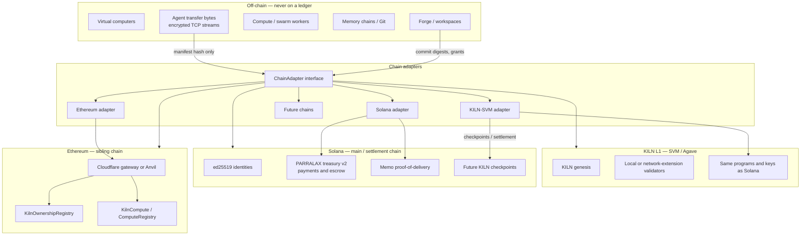

# KILN L1 — a multi-chain SVM network extension

KILN's own chain runs the Solana engine (SVM, Agave). Solana is the
main chain it settles to. Ethereum is a first-class adapter from the
start, and further chains plug in through the same interface.

This document is the architecture. It supersedes the earlier plan of a
sovereign *EVM* KILN L1 ([KILN_L1_OWNERSHIP.md](KILN_L1_OWNERSHIP.md),
[KILN_SOVEREIGN_NETWORK.md](KILN_SOVEREIGN_NETWORK.md)) as the
production chain shape, without throwing that work away: the Foundry
contracts stay as the Ethereum-side ownership and compute surface.
Off-chain behavior is unchanged: files, compute, virtual computers and
agent-transfer *bytes* never go on any chain.

Code for the adapters and the local devnets lives in [`l1/`](../l1/).

## Status (2026-11-26)

**Decided**

- Solana is the settlement / main chain.
- KILN L1 is an SVM chain — same key format, same programs, same
  runtime as Solana — intended to run as a *network extension* (KILN's
  chain inside Solana), not as a separate EVM L1.
- Ethereum is built in from day one, through a configurable RPC
  (Cloudflare's Ethereum gateway in production; Anvil in tests).
- A chain-adapter interface is how KILN talks to every chain, including
  Solana, KILN-SVM and Ethereum.
- File bytes, virtual-computer disks, compute jobs and memory stay
  off-chain. What goes on-chain is identity, payments, escrow, and
  proof-of-delivery receipts (a Memo transaction carrying the manifest
  hash).
- No adapter in this repository will submit to mainnet or spend funds
  on a public cluster. Tests run against local validators only.

**Built in this tree**

- The adapter interface, plus working Solana, KILN-SVM and Ethereum
  adapters (read block / balance, build and sign, submit on a local
  chain, delivery receipts on SVM).
- A local KILN-SVM devnet launcher (`solana-genesis` when it works,
  otherwise `solana-test-validator`) bound to 127.0.0.1.
- A local Ethereum devnet launcher (`anvil`) bound to 127.0.0.1.
- Transfer receipts are submitted *through* the adapters, reusing
  `swarm/lib/transfer-receipt.mjs` without changing its wire format.
  Mainnet remains refused.

**Not built** (see [Open decisions](#open-decisions))

- A production network-extension deployment, a public KILN-SVM
  validator set, or live checkpoints onto Solana mainnet.
- A receipt-gated escrow instruction (the hire → payout flow is
  specified below; the treasury cannot yet release *because* a receipt
  landed).
- Ports of `KilnOwnershipRegistry` / `KilnCompute*` to SVM.
- NAT traversal, QUIC, or multi-receiver transfer (those stay in the
  transfer workstream).

## Why this shape

The code KILN already ships is Solana-native: agent-transfer identities
are `solana-keygen` keypairs and base58 addresses; the optional receipt
is a Memo program transaction; the virtual-computer image pins Solana
CLI 1.18.26 and Anchor 0.30.1; ItsNotAILABS/PARRALAX-AIHFTFUND's agent
treasury (Anchor 0.30.1, layout v2, merged in
[PR #17](https://github.com/ItsNotAILABS/PARRALAX-AIHFTFUND/pull/17))
and Senda's payments (`TransferChecked`, v2 treasury client) use the
same keys and token program. Starting the KILN chain on any other
runtime means a bridge, a second key format and a rewrite.

An Ethereum L2 such as Base is a real alternative if the business needs
EVM tooling or USDC on Coinbase rails as the *settlement* layer. The
cost is rewriting the treasury in Solidity and giving up the keys and
programs that already exist. Ethereum is still in the picture — as an
adapter, and as the home of the ownership/compute contracts already
written in this repo — not as the chain KILN itself runs on.

Running a full KILN SVM chain (rather than posting receipts onto shared
Solana only) is the step that turns the L1 work already in this
repository into a chain: our own genesis, fee policy, and later our
own programs, while keeping Solana as the main chain those programs
and keys stay compatible with.

## What already exists

Searched this repository and the ItsNotAILABS org (repo list + code
search for L1, chain, consensus, validator, genesis, SVM, EVM,
Agave, network extension). Nothing in the org was a running SVM
validator, a custom genesis, or a chain-adapter layer. This is what
was already there:

| Piece | Where | State |
|---|---|---|
| `KilnOwnershipRegistry`, `KilnCompute`, `KilnComputeRegistry` | `contracts/`, Foundry tests and deploy script | EVM contracts, **not deployed**. `deployments/chain.json` is empty. Planned targets were Robinhood Chain (4663) and Monad; see `deployments/README.md`. |
| Ownership, compute and sovereign-network docs | `docs/KILN_L1_OWNERSHIP.md`, `KILN_L1_COMPUTE.md`, `KILN_SOVEREIGN_NETWORK.md`, `KILN_ACCOUNT_FLOW.md` | Describe an EVM-compatible KILN L1. The *rules* (agents do not hold the owner key, source stays off-chain, receipts are compact, two-step transfer) still apply. The *execution* layer is now SVM. |
| In-process grants | `swarm/lib/grant.mjs` | Mirrors the ownership-registry capability bits off-chain. |
| kiln-workspace app | ItsNotAILABS/kiln-workspace | ABI, keccak and UI for the ownership registry. The repo itself says it is "not the L1 contracts repo." |
| Agent transfer + Memo receipts | `swarm/lib/transfer*.mjs`, [KILN_AGENT_TRANSFER.md](KILN_AGENT_TRANSFER.md) | Encrypted, erasure-coded, any-size transfer. Identities are Solana keypairs. A receipt can be built offline; submit is already refused on mainnet and has not been run live against devnet. |
| Virtual computers | [KILN_VIRTUAL_COMPUTERS.md](KILN_VIRTUAL_COMPUTERS.md) | Off-chain agent machines, with Solana and Anchor in the image. |
| Compute, memory, forge | `swarm/lib/compute*.mjs`, `memory*.mjs` | Off-chain. Signed receipts and hash chains live in the repo, not on a ledger. |
| PARRALAX agent treasury v2 | ItsNotAILABS/PARRALAX-AIHFTFUND `solana/programs/agent-treasury` | Anchor 0.30.1, seeds `["treasury", owner, mint, seed_id u64 LE]`, `TransferChecked`, per-tx/daily/lifetime caps, pause/revoke, rotatable agent. **Source only, unaudited, not deployed** outside a local validator. Localnet program id only. |
| Senda treasury client | ItsNotAILABS/Senda `integrations/parralax-treasury` | v2 IDL + instruction builder; not hooked to the live UI; same "not deployed" rule. |
| MonadBuilder / THESIS (OnChain) | ItsNotAILABS/OnChain | A Monad (EVM) product with a Cloudflare production envelope that already mentions an Ethereum L1 JSON-RPC gateway. That is the likely source of "Ethereum access through Cloudflare." It is not a KILN L1. |
| Other org chain work | Stocklana, NATIVE-NOVA-PROTOCOL, NOVA-private-root, sovereign-forge-os, cloudcolony | Solana token/deploy docs, ICP/Motoko, or small Python adapters. None is a KILN SVM chain. |

## Layer diagram



## On-chain versus off-chain

**Off-chain (KILN already does this, and it stays here)**

- File and package bytes, including zips of any size. A Solana
  transaction is about 1.2 KB; the transfer system moves gigabytes on
  parallel encrypted streams instead. See
  [KILN_AGENT_TRANSFER.md](KILN_AGENT_TRANSFER.md).
- Virtual computers (desktop, Chrome, toolchain, owner hand-off).
- Compute jobs, sandboxing, metering (GB-seconds). Heavy numerics stay
  in MatDaemon / the model runtime; the chain only ever sees a digest
  or a verification kernel.
- Git repositories, workspace contents, prompts, secrets, memory.
- The swarm daemon, doctor, and node-local receipt log
  (`receipts.jsonl`).

**On-chain, on Solana and/or KILN-SVM** (same programs can live on
both; settlement and widely-visible proofs prefer Solana)

- Agent identity: ed25519 keys in Solana's format (base58 addresses).
- Payments and escrow: the PARRALAX agent treasury v2 (bounded SPL
  vault, `TransferChecked`, caps, pause, guardian).
- Proof-of-delivery: a Memo instruction whose memo is
  `kiln-transfer:<manifestId>`, where `manifestId` is the 32-byte
  SHA-256 of the canonical manifest. File bytes are not included.
- Later: a settlement account or program that records KILN-SVM
  checkpoints (slot, state root, validator set) on Solana.

**On-chain, on Ethereum** (existing contracts, still undeployed)

- Project ownership, commit/tree digest anchoring, license grants,
  agent capabilities, two-step project transfer
  (`KilnOwnershipRegistry`).
- Compute attestation and cheap verification kernels
  (`KilnCompute`, `KilnComputeRegistry`).

A KILN receipt on any chain must never contain private keys, API
secrets, or raw private source.

## Trust model

1. **Wallets sign. Agents do not hold the owner key.** This is the
   operating law in the README and in the ownership docs, and it does
   not change. An agent spending key may exist inside a treasury
   *because* the program caps it and pins the beneficiary; that key
   still cannot withdraw, rotate policy, or close the vault.
2. **Off-chain transfer proves content to the two parties.** Every
   chunk is SHA-256-checked, the manifest is ed25519-signed, the wire
   is mutually authenticated (X25519 + AES-256-GCM) and
   forward-secret. A third party who only sees a Memo receipt can
   prove that *some* signer paid to publish *that* manifest hash at
   *that* slot. They cannot reconstruct the file.
3. **On-chain escrow is a program, not a promise.** Until a
   receipt-gated release instruction exists, a hire payout is an
   owner-authorized `spend` or `withdraw` after the owner has checked
   the transfer and the Memo receipt. The program does not yet enforce
   that step. See the flow below.
4. **Adapters refuse mainnet submits** in this codebase. A
   misconfigured Cloudflare URL or a Solana mainnet RPC cannot be used
   to broadcast or to spend.
5. **The treasury and the ownership registry are unaudited and
   undeployed.** Treat them as source, not as a place for real funds
   or legal title. Registering a digest proves control of a key at a
   time; it is not a copyright assignment.
6. **KILN-SVM's security, once public, is the validator set and the
   settlement link to Solana.** A local devnet is one process on
   loopback: useful for tests, not a consensus guarantee. A production
   network extension inherits Solana's light-client / checkpoint story
   only after that story is actually implemented and reviewed.

## Flow: agent hires agent → escrow → transfer → receipt → payout

This is the intended money path for one agent paying another for a
package of work (a zip, a model, a repo drop). It composes pieces that
already exist with one gap, called out in step 5.

1. **Hire.** The hirer and the hired agent agree off-chain on the
   deliverable, the mint, the amount, and a deadline. Both already
   have (or create) a Solana-format ed25519 identity — the same key
   `swarm.mjs transfer identity` uses.
2. **Escrow.** The hirer, as treasury *owner*, `initialize`s a v2
   treasury (seeds `["treasury", owner, mint, seed_id]`) with the
   hired agent's address as the fixed `beneficiary`, a spending
   `agent` key, optional `guardian`, caps, and `expires_at`. The
   hirer `deposit`s the SPL amount. The vault is the treasury PDA's
   associated token account. This program is not deployed yet; on a
   local KILN-SVM or `solana-test-validator` it can be.
3. **Transfer.** The hired agent sends the work with `swarm.mjs send`
   (or into a virtual computer). Bytes stay off-chain. The manifest
   id is a 32-byte content hash both sides can recompute.
4. **Receipt.** Either party builds a Memo receipt for
   `kiln-transfer:<manifestId>` and submits it *through a chain
   adapter* — typically KILN-SVM for internal jobs, Solana when a
   public proof is required. `l1/` reuses the existing offline
   builder; the adapter is what broadcasts, and only to an allowed
   local (or explicit Solana devnet/testnet) RPC.
5. **Payout.** *Intended:* a program instruction releases the
   escrowed tokens to the beneficiary only after it has seen a
   confirmed receipt for that manifest id (and, optionally, a
   matching hired-agent signature). *Today:* the treasury has no such
   instruction. The near-term path is that the hirer verifies the
   transfer and the Memo transaction, then authorizes `spend` to the
   already-pinned beneficiary (the `agent` key may be a hirer-held
   release key). `withdraw` returns funds to the owner, and is the
   refund path if the hire fails or expires. A later instruction
   should bind release to the receipt so this is not an honor system.
6. **Close.** After payout or refund, the owner `close`s the treasury.
   Rent deposits return to the owner.

## Key management

KILN currently has more than one key type. They must not be confused.

| Key | Format | Role |
|---|---|---|
| Transfer / treasury / KILN-SVM identity | `solana-keygen` JSON: 64-byte array (seed + pubkey), file mode 0600, base58 address | Signs transfers, Memo receipts, treasury instructions. Created at `<stateDir>/transfer/id.json` on first use. A key made here loads in `solana-keygen` and vice versa. |
| Swarm node identity | PKCS8 ed25519; node id is `hex(sha256(raw pubkey))`. Explicitly **not** an Ethereum address and **not** a Solana address (`swarm/lib/keys.mjs`) | Signs the off-chain tool-receipt log. |
| EVM account | secp256k1, 20-byte address | Signs Ethereum adapter transactions and, once deployed, the ownership/compute contracts. Owner keys stay in a wallet the owner controls. |
| Treasury owner / upgrade authority | Solana-format, should be a **multisig** (Squads or equivalent) before any real funds, per PARRALAX `solana/DEPLOYMENT.md` | Owner can withdraw everything by design. A single hot upgrade authority can replace the program and drain every vault. |
| Treasury agent and guardian | Solana-format, distinct from the owner | Agent can only `spend` to the fixed beneficiary within caps. Guardian can only `pause` and `revoke`. |
| Transfer session keys | Ephemeral X25519, signed by the long-term ed25519 identity | Forward secrecy on the transfer wire. Not ledger keys. |

Unifying the swarm node id with the Solana transfer key is an open
decision. Until then, code should never present a node id as a chain
address.

## Cost estimates

These are **estimates**, for order-of-magnitude planning only. They
are not quotes. Always measure against the live cluster.

**Transaction fees (Solana and KILN-SVM).** The Solana fee is
`base fee + optional priority fee`. The base fee is a protocol
parameter, currently **5,000 lamports per signature** (1 SOL =
1,000,000,000 lamports, so 0.000005 SOL per signature). Half of the
base fee is burned; half goes to the leader. The priority fee is
optional, depends on demand, and is not a constant — read it from
`getRecentPrioritizationFees` or a provider, never from this
document. A transaction is charged even if it fails. Sources:
[Fee structure](https://solana.com/docs/core/fees/fee-structure),
[Transaction landing](https://solana.com/developers/docs/tools/transaction-landing).

Worked examples at the current base fee, **ignoring priority fees and
price in dollars** (do not hard-code a USD figure):

- A Memo proof-of-delivery (one signature, the existing receipt
  builder) costs a base fee of 5,000 lamports.
- A treasury `spend` / `deposit` / `withdraw` that does not create
  accounts is the same order of magnitude (one signature plus compute;
  priority fee extra under load).
- `initialize` also funds **rent deposits** for the new treasury
  account and its associated token account (see below). Those are not
  fees: they return to the owner on `close`.

**Rent (storage deposit).** Every account holds a refundable minimum
balance proportional to its size:
`(128 + data_size_bytes) × lamports_per_byte`. The rate is a network
parameter and has been changing under SIMD-0437; official docs around
October 2026 quote **5,080 lamports per byte** on mainnet and devnet,
and give a Token-program token account (165 bytes) as about 0.0015
SOL. **Do not hard-code that.** Ask the cluster with
`getMinimumBalanceForRentExemption`. Local `solana-test-validator`
may still use an older rate. Sources:
[Rent](https://solana.com/developers/docs/core/rent),
[getMinimumBalanceForRentExemption](https://solana.com/docs/rpc/http/getminimumbalanceforrentexemption).

**Ethereum.** Gas is priced in the fee market of the target chain
(Anvil is free; Ethereum L1 and L2s are not). This repo will not
submit there from tests or from the default adapter. Ownership-registry
deploys were previously estimated only from Foundry *simulations* on
Robinhood Chain / Monad — those numbers do not apply to Ethereum L1
and are not repeated here.

**Off-chain transfer** is a bandwidth cost, not a chain fee. A 1 GB
file on the loopback benches in
[KILN_AGENT_TRANSFER.md](KILN_AGENT_TRANSFER.md) moved at a few
hundred MB/s encrypted; a real internet link will be slower than that
and still far cheaper than putting bytes on a ledger.

## Chain adapters

Every chain KILN talks to implements the same interface
(`l1/lib/adapter.mjs`):

- identity: `id`, `family` (`svm` or `evm`), `network`
  (`local` / `devnet` / `testnet` / `mainnet`);
- `getHealth()`, `getBlock()`, `getBalance(address)`;
- `buildTransfer` / `sign` / `submit` — `submit` throws on mainnet
  and on any refused RPC URL;
- SVM: `getLatestBlockhash()`, `buildDeliveryReceipt`,
  `submitDeliveryReceipt`.

**Solana adapter.** JSON-RPC to a configured URL
(`KILN_SOLANA_RPC_URL`). Submit is allowed only to
`http://127.0.0.1|localhost:<port>`, `https://api.devnet.solana.com`,
or `https://api.testnet.solana.com` — the same allow-list as
`transfer-receipt.mjs`. Mainnet is refused.

**KILN-SVM adapter.** The same SVM methods, pointed at the KILN
devnet (`KILN_SVM_RPC_URL`, default `http://127.0.0.1:18899`).
Submit is **localhost only**. This is our chain: same keys and
programs, our genesis.

**Ethereum adapter.** JSON-RPC to `KILN_ETH_RPC_URL` or
`CLOUDFLARE_ETH_GATEWAY_URL` (the Cloudflare Ethereum gateway, or
Anvil). No gateway URL or token is stored in the repo. Reads may use
a configured public or Cloudflare endpoint; **submit is localhost
only**, and chain id 1 is always refused for submit. Existing Foundry
contracts are the intended program surface on this adapter once an
owner deploys them to a chain they have chosen.

**Adding a chain.** Implement the interface, register it in
`l1/lib/adapter.mjs`, give it an allow-list, and add tests that run
against a local simulator. Do not introduce a new signing path that
bypasses the owner wallet for owner-level actions.

## The KILN-SVM chain

### Runtime

The engine is Agave / SVM — the same client already pinned at
**1.18.26** in the virtual-computer image and already installed for
this work (`solana`, `solana-genesis`, `solana-test-validator`,
`agave-validator`). Programs are ordinary Solana programs (Anchor
0.30.1 for the treasury). Identities do not change when a
transaction is sent to KILN-SVM instead of Solana.

### Local devnet

`node l1/kiln-l1.mjs svm start` writes a dedicated ledger under
`l1/.devnet/`, tries `solana-genesis` with KILN parameters
(`l1/genesis/kiln-svm.json`: `cluster-type=development`, short
epochs, `hashes-per-tick=sleep`, a KILN faucet), then starts
`solana-test-validator` on **127.0.0.1** at a non-default RPC port.
If the custom genesis cannot be booted, the launcher falls back to
the test validator's own genesis and records the hash it actually
ran. This is a single-process development chain, not a validator
set.

### Network extension and settlement

In production, KILN-SVM is meant to sit *inside* Solana as a network
extension (or an equivalent Solana-compatible appchain): KILN
executes, Solana remains the main chain that checkpoints and
settles. The exact framework (a custom Agave cluster, a Solana
Network Extension, or another SVM appchain stack) is an open
decision. Until one is chosen and audited, there is no public KILN
chain and **no checkpoint is posted to Solana mainnet**.

A later settlement transaction on Solana should carry a compact
commitment: KILN slot, state root (or similar), and a proof the
chosen framework defines. It should use the same mainnet-refusal
discipline as receipts until an explicit, reviewed production
switch is flipped by the owner.

### When to leave shared Solana (and what it costs)

Triggers that would justify a public KILN-SVM network, rather than
only posting receipts and treasury transactions on shared Solana:

- a fee market or congestion on shared Solana that breaks agent
  receipt or payout SLAs, and that a KILN fee policy would fix;
- a need for private or application-specific transaction traffic
  that should not sit in the Solana mempool;
- a need to enforce KILN-specific validity rules (for example,
  receipt-gated escrow) at the chain layer;
- a business decision to run validator economics for KILN itself.

Costs of that move: you run (or pay) validators; you take on
**bridge / settlement risk** between KILN-SVM and Solana; liquidity
and public proofs can fragment; you need upgrade governance, paging,
snapshots, and an independent security review before any real
value. Do not start this because it sounds like an L1. The local
devnet exists so the adapters and programs can be built first.

## Ethereum

Ethereum is a sibling chain, not the KILN settlement layer.

- Production RPC is expected to be **Cloudflare's Ethereum
  gateway**, configured with `KILN_ETH_RPC_URL` or
  `CLOUDFLARE_ETH_GATEWAY_URL`. If the gateway needs a token, that
  belongs in the environment too (`KILN_ETH_RPC_TOKEN` or a
  Cloudflare-specific secret), never in git. The URL itself is not
  in this repository — it has to come from the owner's Cloudflare
  account.
- Local tests use Anvil on 127.0.0.1.
- `KilnOwnershipRegistry` and the compute contracts are the
  Ethereum-side L1 surface that already exists in `contracts/`.
  Deploying them is an owner action, with a dedicated deployer key,
  and is out of scope for the default adapter tests.

## Alternatives

| Option | What you get | What it costs | Verdict |
|---|---|---|---|
| **Shared Solana only** (no KILN chain) | Fast path for receipts and the treasury; no validators to run | No KILN-specific fee policy or private execution; KILN remains a guest | Fine as the *first* production settlement path; not a KILN L1 |
| **KILN-SVM network extension settling to Solana** (this doc) | Same keys and programs; a real KILN chain; Solana stays the main chain; Ethereum via adapter | Validators, settlement risk, a framework choice, audits | **Chosen** direction |
| **Sovereign EVM L1** (earlier docs: Anvil → Monad → sovereign EVM) | Uses the contracts already in this repo as the native runtime | Second key format; rewrite of transfer receipts and the treasury; abandons the Solana-native stack | Not the production chain. Contracts remain on the Ethereum adapter |
| **Ethereum L2 (e.g. Base) as settlement** | EVM tooling, USDC on Coinbase rails | Rewrite the treasury in Solidity; bridge the existing Solana identities or abandon them | Only for a hard business reason |
| **ICP / other org chains** (NOVA, cloudcolony, …) | Existing ItsNotAILABS work on those platforms | Different VM, keys, and operational story | Out of scope for KILN L1 |

## Open decisions

1. **Which network-extension / SVM appchain framework** to use in
   production (custom Agave cluster, Solana Network Extension, or
   another stack), and who runs the first validator set.
2. **What exactly is checkpointed** onto Solana, in which program,
   and when any of that is allowed to touch mainnet.
3. **Fate of the Solidity contracts.** Recommendation: keep them as
   the Ethereum adapter's ownership and compute surface; port a
   sibling registry to SVM only if KILN-SVM needs the same
   primitives natively. Not: silently delete, and not: deploy them
   to Robinhood Chain just because that was an earlier target.
4. **Receipt-gated treasury release** — add an instruction, or keep
   owner-authorized `spend` after an off-chain check?
5. **Settlement mint** (USDC or something else; Token vs Token-2022;
   which mint addresses on which cluster).
6. **Unify swarm node identities with Solana transfer keys?**
7. **Cloudflare Ethereum gateway URL and whether it needs a token.**
   Placeholder env vars are in place; the actual values have to come
   from the owner.
8. **When, if ever, to allow submit to Solana devnet or Ethereum
   testnets from this repo's tools** (already allow-listed for
   Solana devnet/testnet, never used by the default tests).
9. **Who pays Memo receipt fees** — sender, hired agent, or a KILN
   fee-payer.
10. **Audit, upgrade authority, and owner multisig** before any
    treasury holds real funds (already required by PARRALAX
    `DEPLOYMENT.md`).

## Running the local chains

```bash
# KILN-SVM (solana-test-validator on 127.0.0.1:18899)
node l1/kiln-l1.mjs svm start
node l1/kiln-l1.mjs health --chain kiln-svm

# Ethereum (anvil on 127.0.0.1:18545)
node l1/kiln-l1.mjs eth start
node l1/kiln-l1.mjs health --chain ethereum

# Delivery receipt through the adapter (localhost only)
node l1/kiln-l1.mjs receipt submit --chain kiln-svm --manifest-id <64 hex>

node l1/kiln-l1.mjs svm stop
node l1/kiln-l1.mjs eth stop
```

Unit tests do not need a validator. Integration tests start local
chains and **skip** if `solana-test-validator` or `anvil` is missing.
They never target a public network.

```bash
node --test l1/test/*.test.mjs
```
