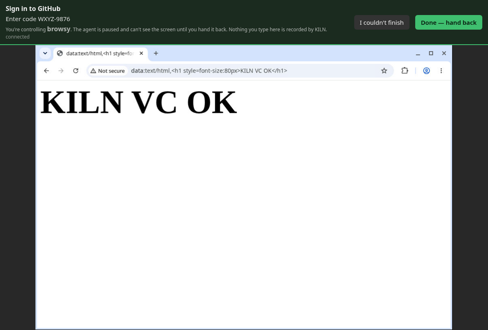

# KILN Virtual Computers — a real machine per agent

A KILN virtual computer is a persistent machine an agent owns: a real
desktop with Chrome, a pinned dev toolchain, and a control API to see the
screen, move the mouse, type, and run shell commands. When something needs
a person (a sign-in, a device code, 2FA, a captcha), the agent **hands the
screen to the owner**. The agent is paused, the owner gets a one-time link
with the live desktop and an instruction banner, and a "hand back" button
gives the agent its machine back.

It's modeled on the agent box KILN's operators already work on, where the
GitHub device-code sign-in was done this way.

Code: `swarm/lib/vcomputer*.mjs`, the image in `swarm/vcomputer/image/`,
tests in `swarm/test/vcomputer-*.test.mjs`.

## What you get

| | |
|---|---|
| **Desktop** | Xvfb virtual display (default 1280×800) + xfwm4 window manager |
| **Browser** | Chrome for Testing (pinned), profile in `~/.config/kiln-chrome`. Logins and cookies persist with the home. Relaunched if closed or crashed |
| **Home** | `/home/agent`, a named docker volume (`kiln-vc-<id>-home`). Survives stop/start, restarts and image upgrades |
| **Toolchain** | git, gh 2.103.0, Node 24.22.3 LTS + pnpm 10.34.6 + bun 1.4.4, Python 3.13, Rust 1.79.0 (rustup, clippy, rustfmt), Solana CLI 1.18.26 + Anchor 0.30.1, poppler-utils, build-essential/clang/cmake, ffmpeg |
| **Control API** | screenshot, input (move/click/type/key/scroll/drag), shell exec with timeouts, background jobs |
| **Hand-off** | owner takeover over noVNC, with the agent locked out until hand-back |
| **Limits** | CPU, memory (no swap past the cap), pids, disk quota, idle shutdown |

## Backends

| backend | isolation | use it for |
|---|---|---|
| `docker` (default) | one container per computer from the `kiln-vc` image. It runs as the unprivileged `agent` user with its own pid/mount/uts/net namespaces, `--cap-drop ALL`, `no-new-privileges`, and cgroup limits | real agents |
| `local` | **none**: the same desktop scripts run as host processes under the daemon's user, with a per-computer `HOME` | development and tests on a host without a container runtime. Refused unless the daemon runs with `KILN_VC_ALLOW_LOCAL=1` |

Both backends run the same scripts (`swarm/vcomputer/image/bin/kiln-vc-*`),
so the desktop the local tests drive is the desktop the image ships. Podman
works in place of docker with `KILN_VC_DOCKER=podman`.

## Build the image

```sh
swarm/vcomputer/image/build.sh            # -> kiln-vc:1.0.0
```

Every input is pinned in `swarm/vcomputer/image/versions.env` and verified
at build time:

- the base image by digest;
- apt packages through a fixed `snapshot.debian.org` date;
- each downloaded tool by sha256. That covers Node, bun, gh, rustup, the
  Agave/Solana tarball and Chrome for Testing.

Anchor 0.30.1 has no release binaries, so it is built from its tag with
`--locked`. Rust is pinned to 1.79.0 because anchor-cli 0.30.1 does not
compile on 1.80+. The build ends by running `kiln-vc-toolcheck`, so a
missing or broken tool fails the build. The image is about 3.7 GB.

## API

Everything below is operator-only (bearer `api.token`), like `/v1/compute`.
It is also in `GET /v1/openapi.json` and `GET /v1/capabilities` (ability
`vcomputers`).

```
POST   /v1/vcomputers                 {name, backend?, width?, height?, cpus?, memoryMB?, diskMB?, pidsLimit?, idleTimeoutSec?, browser?, network?}
GET    /v1/vcomputers                 list (live status)
GET    /v1/vcomputers/doctor          health
GET    /v1/vcomputers/:id
DELETE /v1/vcomputers/:id?purge=true  purge also deletes the home
POST   /v1/vcomputers/:id/start | /stop
GET    /v1/vcomputers/:id/screenshot  {width, height, png: base64} | ?format=png -> image/png
POST   /v1/vcomputers/:id/input       {action, ...}
POST   /v1/vcomputers/:id/exec        {command, timeoutMs?, cwd?, stdin?, background?}
GET    /v1/vcomputers/:id/jobs
GET    /v1/vcomputers/:id/jobs/:jobId?tail=BYTES
POST   /v1/vcomputers/:id/jobs/:jobId/kill
POST   /v1/vcomputers/:id/handoff     {reason, instructions?, timeoutSec?}
GET    /v1/vcomputers/:id/handoff?waitMs=N
DELETE /v1/vcomputers/:id/handoff
GET    /v1/vcomputers/:id/toolcheck
```

Defaults: 1280×800, 2 CPUs, 4096 MB, 20 GB disk, 4096 pids, idle stop after
30 min, browser on, network on.

**Input.** A point is either pixels (`x`, `y`, which must be on screen) or
the SCREEN-KERNEL convention from vLaptop (`nx`, `ny` in 0..1 of the
frame). Points off the screen are refused, never clamped.

- `move {x,y}`
- `click {x?,y?, button: left|middle|right, count: 1..3}`
- `type {text, x?,y?}`: the text goes to xdotool **on stdin**, never in
  argv, and is never logged
- `key {keys: "ctrl+l" | ["ctrl+l","Return"]}`: X keysyms only
- `scroll {dx?, dy?, x?,y?}`: wheel notches, `dy > 0` scrolls down
- `drag {x,y,x2,y2}`

**Exec.** Runs `bash -lc` inside the machine as the agent user.

- **Foreground** waits up to `timeoutMs` (1000..600000, default 60000). On
  expiry the whole process group gets TERM, then KILL 2 s later. The
  response carries `exitCode`, `stdout`, `stderr`, `timedOut` and
  `truncated`, with a 1 MB cap on each output stream.
- **Background** (`background: true`) returns `202 {jobId}`. The job runs
  in its own session. Its output and exit code go to
  `~/.kiln/jobs/<jobId>/`, and jobs can be listed, tailed and killed.
- **Environment.** Local-backend machines get an allowlisted environment,
  so the daemon's secrets never enter them.

**Errors.**

| status | meaning |
|---|---|
| 423 | the owner has the screen |
| 409 | the machine isn't running |
| 507 | over the disk quota |
| 503 | the backend is unavailable; the message says why (no docker, image not built, local not allowed) |

### SDK and CLI

```js
import { VComputerClient } from "<kiln>/swarm/lib/vcomputer-client.mjs";
const kiln = await VComputerClient.connect();
const pc = await kiln.createComputer({ name: "agent-1" });
await kiln.key(pc.id, "ctrl+l");
await kiln.type(pc.id, "github.com/login/device\n");
const { png } = await kiln.screenshot(pc.id);
const ho = await kiln.handoff(pc.id, { reason: "Sign in to GitHub", instructions: "Enter code ABCD-1234" });
// send ho.url to the owner, then:
await kiln.waitForHandBack(pc.id);
```

```sh
node swarm.mjs vc create --name agent-1
node swarm.mjs vc exec agent-1 --cmd "gh auth status"
node swarm.mjs vc screenshot agent-1 --out shot.png
node swarm.mjs vc handoff agent-1 --reason "Sign in to GitHub" --instructions "Code ABCD-1234" --wait
node swarm.mjs vc doctor
```

## Hand-off



The hand-off is a pure state machine (`lib/vcomputer-handoff.mjs`):

```
pending ──open──▶ active ──return──▶ returned
   ├──────return──────────┘
   ├──cancel (agent/operator)──▶ cancelled
   └──expire (timeoutSec, 60..3600, default 900)──▶ expired
```

1. The agent calls `POST …/handoff {reason, instructions}`. KILN starts
   x11vnc + websockify inside the machine. They exist only while a
   hand-off is open. KILN then returns `url` once.
2. While the hand-off is open, the agent gets **423** on screenshot, input,
   exec and jobs. It can't read a code or password off the screen while
   the owner works.
3. The owner opens the link. The page shows the `reason` and
   `instructions`, the live desktop (noVNC), and two buttons: **Done, hand
   back** and **I couldn't finish**.
4. On hand-back, cancel or expiry, KILN stops the viewer and forgets the
   VNC password. The link then answers 410, and the agent's long-poll
   (`GET …/handoff?waitMs=`) returns with the outcome.

**Secrets.**

- The owner's keystrokes go browser → websocket → VNC → X server. The
  daemon proxies the websocket as raw bytes and never parses RFB.
- The token is 256 random bits. Only its sha256 is stored, and it is
  compared in constant time. It never appears in logs, records or API
  views; the tests grep the whole state dir and the daemon output for it.
- The VNC password is per hand-off and held in daemon memory. It reaches
  x11vnc through a file that x11vnc deletes on read.
- The `return` body is ignored beyond `outcome`.
- The activity log (`activity.jsonl`) records only the length of text the
  agent types.
- The page is served with:
  - `no-store`
  - `Referrer-Policy: no-referrer` (the token is in the URL)
  - `X-Frame-Options: DENY`
  - a nonce CSP

  The websocket upgrade is refused for a foreign `Origin`.

**Reaching the page.** The daemon binds 127.0.0.1, so by default the link
works on the KILN host only. That includes an SSH tunnel, or the owner
using the box's own desktop. For a remote owner, set
`KILN_VC_HANDOFF_BASE_URL` (or `vcomputers.handoffBaseUrl` in config) to an
HTTPS origin that proxies `/handoff/*` and `/handoff-assets/*`, websockets
included, to the daemon. The preview relay (`docs/KILN_PREVIEW.md`) is the
natural carrier, but wiring it is **not done yet**.

## Limits, idle shutdown, health

- **CPU / memory / pids** are cgroup limits on the docker backend
  (`--cpus`, `--memory` = `--memory-swap`, `--pids-limit`). The local
  backend does not enforce them; it reports `isolation: "none"`.
- **Disk** is a soft quota. The daemon sweep measures the home with `du`
  every 60 s. Over `diskMB`, the computer is flagged: start and new
  background jobs answer 507, and foreground exec still works so the agent
  can clean up. Hard per-volume quotas need an xfs/pquota docker root,
  which this host doesn't have.
- **Idle shutdown.** The daemon tick sweeps every `KILN_VC_SWEEP_MS`
  (default 30 s). It stops a running computer with no control-API
  activity for `idleTimeoutSec`, as long as there's no open hand-off and
  no running background job. It records `stoppedReason: "idle"` and keeps
  `desired: "running"`. The next `start` brings the computer back with its
  home intact.
- **Doctor.**
  - `GET /v1/vcomputers/doctor` and `swarm.mjs vc doctor` report backend
    availability (docker reachable, image built, local allowed) and
    per-computer problems: should be running but isn't, over quota, or a
    stale hand-off. `vc doctor` exits 1 on any problem.
  - `swarm.mjs doctor report` includes a one-line summary.
  - `doctor check` (the cron) deliberately stays about the daemon only.
  - `vc toolcheck <id>` prints the pinned tool versions inside a machine.

## Tests

```sh
cd swarm
node --test test/vcomputer-handoff.test.mjs test/vcomputer-input.test.mjs   # pure
node --test test/vcomputer-local.test.mjs    # real daemon + Xvfb/xdotool/x11vnc/websockify
node --test test/vcomputer-docker.test.mjs   # real daemon + docker + built image
```

The local and docker suites skip with a reason when their tools or image
are missing.

## Relation to vLaptop

`ItsNotAILABS/vlaptop` is the SCREEN-KERNEL contract: see / touch / type /
click over a framebuffer, normalized 0..1 coordinates, served by a Python
host or by Pocket. KILN virtual computers adopt its coordinate rule
(`nx`/`ny`, out-of-range refused), but they are a different layer. Each one
is a whole isolated Linux machine with a real browser, toolchain and
persistence. vLaptop is a screen protocol, with a 320×184 virtual
framebuffer or the host's own monitor. Neither depends on the other.
Exposing a virtual computer *through* SCREEN-KERNEL (so Pocket or a phone
can drive it) is a clean follow-up: a vLaptop host whose framebuffer is
this screenshot API.

## Not done (honest list)

- **Remote owner access** to the hand-off page needs a proxy. The base URL
  is configurable, but the preview relay doesn't carry `/handoff/*` yet.
- **MCP tools.** The ability is HTTP + SDK + CLI only.
- **Per-account / per-agent ownership.** Computers are operator-only, like
  compute. Agent tokens can't create or drive their own yet.
- **A hard disk quota.** The quota is soft (measured, enforced at start
  and for background jobs).
- **Chrome sandbox.** Chrome runs with `--no-sandbox` inside the
  container; the container is the boundary. A seccomp profile that
  permits Chrome's user-namespace sandbox would restore it.
- **Image publishing.** The image is built locally from `build.sh`. No
  registry push and no CI image build yet.
- **GPU.** None: software rendering only.
